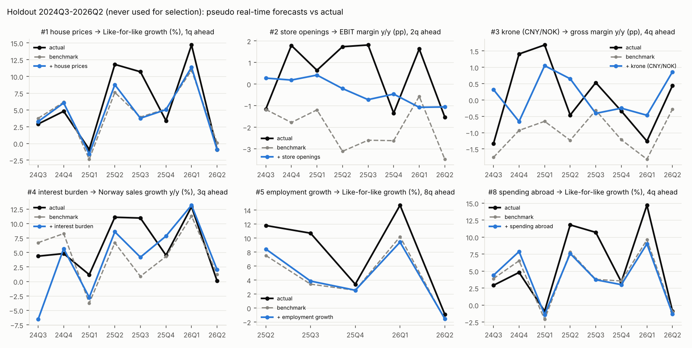
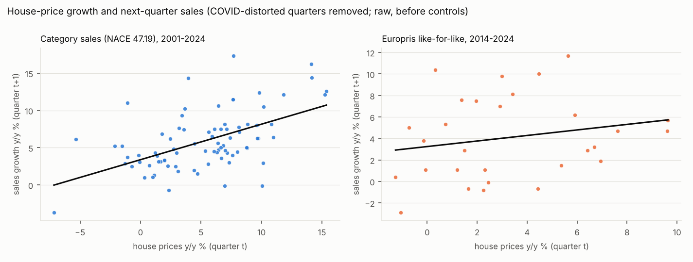
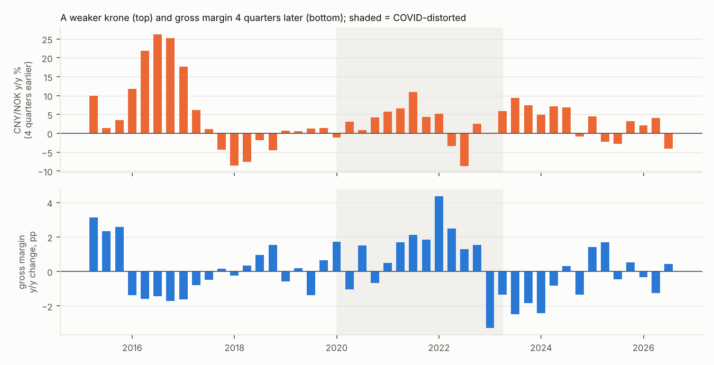

# What predicts Europris's Norwegian financials?

**Question.** Which variables help predict Europris ASA's Norwegian sales, like-for-like (LFL) growth, gross margin and EBIT margin? We need at least two that work 1–4 quarters ahead and at least two that work 4 or more quarters ahead.

**Data.** Europris's own quarterly reports, 2014Q1–2026Q2 (50 quarters, independently verified), and about 110 candidate features. Of these, 92 are built from ~440 Norwegian macro, market and survey series; a later round added 18 from new sources: Europris inventory, sea-freight prices, housing activity, household interest burden and relative share price.

**Method.** Each candidate gets out-of-sample tests with calibrated small-sample inference, a 25-year category proxy, an untouched holdout (2024Q3–2026Q2), and four rounds of independent replication and adversarial review.

## The answer

| # | Variable | What it predicts | Horizon | Effect size | Evidence grade |
|---|---|---|---|---|---|
Calendar effects (Easter timing and shop trading days) are left out of this list because they are obvious. They are still the strongest predictors of sales and LFL, and they are controlled for in every model below (see [Calendar controls](#calendar-controls-easter-timing-and-trading-days-established)).

| # | Variable | What it predicts | Horizon | Effect size | Evidence grade |
|---|---|---|---|---|---|
| 1 | **House prices**, y/y % (SSB) | Sales and LFL growth | **1–2 quarters** | ~0.3 pp LFL (0.4–0.5 pp sales) per 1 pp of house-price growth | **Moderate** |
| 2 | **Store-opening pace**: Europris chain store count, y/y growth | EBIT-margin change (negative) | **2 quarters** | ~−1.1 to −1.5 pp EBIT margin per 1 pp faster store growth | **Fragile** |
| 3 | **Krone vs Chinese yuan / US dollar**: CNY/NOK y/y %, USD/NOK similar | Gross-margin change (negative) | **4 quarters** | A 10% weaker krone means ~−0.8 to −1.3 pp gross margin a year later | **Fragile** |
| 4 | **Household interest burden**: interest expenses / disposable income excl. dividends (SSB 11020), y/y change | Sales growth (negative) | **3–4 quarters** | +1 pp in the burden means ~−1.3 to −2.6 pp sales growth 3–4 quarters later | **Weak** |
| 5 | **Employment growth**: register-based employed persons, y/y % (SSB) | LFL growth (positive) | **~8 quarters** | +1 pp employment growth means ~+1.3 to +1.8 pp LFL about two years later | **Weak** |

Short-term (1–4 quarters): #1 and #2. Long-term (4+ quarters): #3, #4 and #5.

**The single most important finding is a negative one.** Once the calendar and Europris's own recent figures are in the model, no macro or market variable is statistically established after correcting for the number of candidates tried (≈1,700 tests). Across all of them, the share of p ≤ 0.05 is 3–7%, which is what chance produces.

- **House prices** are the only signal that holds up in two independent samples.
- **Long horizons:** economic predictability of Europris's Norwegian numbers is weak. #3–#5 are the best long-horizon candidates, and each has a specific weakness (below).

### Grades

- **Established:** passes exact randomisation tests at every horizon and is positive in the holdout.
- **Moderate:** consistent across two independent samples, but thin on Europris data alone.
- **Fragile:** significant on Europris in both COVID treatments (calibrated p < 0.05), but driven by one episode or not confirmed out of sample. Use it as a risk flag, not a forecasting rule.
- **Weak:** below the fragile bar (significant in only one COVID treatment, or p 0.05–0.10 in both), but signed consistently across independent checks. These are the best of the non-calendar candidates in the fourth round. Use them only as a directional tilt.



## Evidence per variable

All p-values come from calibrated randomisation tests (see Method). R² values compare out-of-sample forecasts against the benchmark without the variable. "Primary" means COVID-distorted quarters are excluded; "control" means they are kept with COVID controls. Holdout = 2024Q3–2026Q2, 8 quarters, never used for selection.

### Calendar controls: Easter timing and trading days (established)

**Joint test of both calendar terms.** Exact placebo-calendar test (each quarter's calendar replaced by the same quarter in 266 other years). For LFL, p ranges from 0.004 (the test's floor) to 0.034 at every horizon from 1 to 8 quarters, in both COVID treatments. For sales growth, p ranges from 0.004 to 0.04, except h=4–6 in the primary spec (p 0.07–0.10). Source: `results/calendar_joint.csv`.

**Easter timing alone.** Placebo p is 0.001–0.05. The holdout R² is positive in all 15 computable horizon × spec × target cells (+0.30 to +0.75). Adding the Easter term cuts the LFL holdout forecast error from ~5.3 pp to ~3.3 pp RMSE.

**Trading days alone.** Placebo p is 0.001–0.026 for LFL. Holdout R² for LFL is +0.08 to +0.46, except one −0.02 cell. For total sales the holdout R² ranges from −0.28 to +0.50.

**How well the trading-day count matches management.** It reproduces every sales-day difference management quotes in the reports (Q1 2016 −2, Q2 2016 +3, Q1 2017 +3, Q2 2017 −4, Q1 2018 −2, Q2 2018 +2, Q3 2018 −1, Q4 2023 −2, Q1 2024 −2, Q2 2024 +2, Q4 2024 +1).

Neither calendar term predicts gross margin or EBIT margin.

### 1. House prices → sales next 1–2 quarters (moderate)

**Europris, primary spec.** LFL h=1: p 0.020 (t 2.0). Sales h=1: p 0.030. LFL h=2: p 0.043. The control spec has the same sign but is weaker (p 0.11–0.32).

**25-year category proxy** (SSB retail sales, NACE 47.19, "non-specialised non-food stores"; Europris is a large share of it — Euromonitor puts it at about two-thirds of general-merchandise stores):
- 2001–2024: p 0.005, slope 0.39.
- **Before 2015 only, so independent of the Europris sample:** p 0.044.
- The slope is positive in every sub-period.

**Holdout.** LFL R² is +0.15 / +0.18 at h=1 and +0.22 / +0.27 at h=2 (primary / control). Sales R² is +0.23 / +0.08 at h=1.

**Caveats.**
- Adding two extra own lags of the target pushes the Europris p to 0.066.
- House-price growth may partly carry category momentum.
- Use a small coefficient (~0.3–0.4), not the free Europris estimate.



### 2. Store-opening pace → EBIT margin 2 quarters later (fragile)

**Statistics.** p 0.011 (primary, n=15) and 0.028 (control). Robust to extra own lags (p 0.007) and to dropping 2016. Holdout R² is +0.67 / +0.32.

**Caveats.**
- Significance leans on 2019. High store growth in late 2018 lines up with the 2019 EBIT-margin falls, which the reports attribute to central-warehouse cost overruns. Dropping 2019 or controlling for the warehouse costs gives p 0.06–0.19.
- The effect shows up in gross margin, not in the opex ratio, so the start-up-cost story is unproven.
- The store pipeline is pre-approved by the board, so this is known in advance.

### 3. Krone (CNY/NOK; USD/NOK similar) → gross margin 4 quarters later (fragile)

**Mechanism.** USD is ~30% of purchases. Purchase orders are hedged up to 6 months and inventory turns in ~5 months, so a weaker krone should reach cost of goods 3–4 quarters later. Management says this repeatedly.

**Europris statistics.**
- p 0.028 (primary) and 0.016 (control).
- Robust to extra own lags (p 0.027).
- The sign matches the prior written before the analysis.
- It is the only economic variable that passes the strict exploratory rule at ≥4 quarters.

**Why it is only fragile.**
- **One episode:** the result rests on the 2015–16 oil-price and krone shock. Without 2016 the t-stat falls to −1.8 (primary) and −0.3 (control).
- **Not confirmed at peers with the same sourcing model:**
  - *Clas Ohlson* (97 quarters, 2002–2026, USD/SEK): no 4-quarter effect (p 0.48); a fragile 1–2 quarter effect.
  - *Kid ASA* (2015–2026): nothing significant.
- **Holdout is mixed:** R² +0.26 / −0.37. In 2025–26 management passed the stronger krone on to customers rather than keeping it as margin.

Treat it as a risk flag after large krone moves (roughly ±10% y/y), not as a routine forecasting input.



### 4. Household interest burden → sales growth 3–4 quarters later (weak; new)

**What it is.** Households' interest expenses as a share of disposable income excluding dividends (SSB sector accounts, table 11020), y/y change in pp. Its level tracks Norges Bank's published burden: 12.5% in 2008Q4, 5.5% in 2021, 11.7% in 2024Q4. Most Norwegian mortgages are floating-rate, so rate changes reach household cash flow within a few quarters.

**Statistics.**
- COVID-control spec: p 0.012 / 0.036 / 0.030 at h=2/3/4.
- COVID-excluded spec: p 0.52 / 0.21 / 0.19.
- The sign is negative at every horizon from 1 to 5.
- It is the only new candidate that survives the existing picks in both specs (p 0.058 / 0.066). The loan-rate version (`new_hhf_loan_rate__d4`) behaves similarly.

**Independent checks.**
- The sign is negative in the 25-year category data (pre-2015 t −1.5, not significant), in the 2008–09 cycle (t −3.3 to −3.8 at h=4–6, p 0.16–0.24), and in 11 of 12 holdout cells.
- Holdout R² is mixed: +0.28 (primary) and −0.45 (control) at h=4; −0.22 / +0.21 at h=3.

**Why only weak.**
- Significance needs the 2020Q1–2023Q2 targets. Dropping them gives p 0.25–0.52.
- It does not show up in like-for-like growth, only in total sales.
- It is largely the same information as the policy-rate change, which was tested and rejected on its own.
- Adding extra own lags removes it (p ≈ 0.18).

**Current reading.** The burden is falling (−0.7 pp y/y in 2026Q2, level 11.0%), a mild sales tailwind into 2027H1. Norges Bank's May 2026 hike will turn this around with a lag.

### 5. Employment growth → like-for-like growth ~2 years later (weak; new)

**What it is.** Register-based employed persons (SSB, seasonally adjusted, final figures with a 54-day publication lag), y/y %.

**Statistics.**
- LFL at h=8: p 0.060 (primary) and 0.078 (control).
- Robust to dropping 2016 (p 0.022 / 0.098) and to dropping 2022–23 (control 0.081).
- Positive at the neighbouring horizons h=7 and h=9 in both specs.
- Positive slope in both 2015–19 and 2023–24.
- It ranked first of six candidates on a uniform 15-check robustness battery (10/15).

**Holdout.** +0.10 (control spec, 8 quarters); the primary spec has only 5 holdout quarters, too few to score.

**Why only weak.**
- p is above 0.05 in both specs.
- The COVID-excluded sample is 15 targets from 2016–19, and nothing shows up at shorter horizons.
- The pre-2015 category data have the opposite sign (t −2.4 at h=8).
- In the COVID-excluded spec the krone pick absorbs it (p 0.24).

**Current reading.** +0.6% y/y in 2026Q2, close to its recent average, so roughly neutral for 2028.

### Runners-up (tested, not good enough)

| Variable | Result | Why it was not included |
|---|---|---|
| Finans Norge consumer sub-index "Norway's economy next year" → gross margin, 2–4 quarters | Control spec p 0.002–0.016; primary spec p 0.11–0.28; holdout +0.29/+0.03 (h2), +0.53/−0.12 (h4) | Only significant when COVID quarters are kept; moves with the krone (r = −0.73); sibling confidence indices show nothing; absorbed by store pace and FX |
| Household purchases abroad (cross-border shopping and travel) → LFL, 4 quarters | p 0.027 / 0.014, formally passes the fragile bar | **Spurious:** ~87% holiday travel, not cross-border shopping; isolated spike at h=4; the 25-year category data have the opposite sign at every horizon; the holdout relation reversed (2024–25 income recovery lifted both travel and Europris) |
| Europris share price relative to OSEBX → EBIT margin, 2 quarters | p 0.062 / 0.084 | The store-pace pick fully absorbs it; the 2023–24 slope has the wrong sign |
| Europris inventory (growth, excess vs sales, days of inventory) → margins, 1–4 quarters | Right sign for next-quarter gross margin but p 0.07–0.08 (primary only); an "excess inventory → sales, 3 quarters" hit (p 0.0003) | No pre-registered sales sign, and holdout R² −1.6 / −1.5 |
| Sea-freight prices (INSEE index; no Asia–Europe spot index was reachable) and Europris's announced freight-contract regime → gross margin | Nothing at 4+ quarters; contract regime p 0.015 at h=2 on 4 in-sample quarters | Europris's 1–2 year contracts decouple its cost from spot rates; holdout −6.6 / −0.4 |
| Housing activity (homes sold, days on market, completions, under construction) → sales/LFL | Chance level (5.4% of tests at p ≤ 0.05) | Only COVID-era significance; days on market mirrors house prices (r ≈ −0.85) |
| Household saving ratio change → LFL, 6 quarters | p 0.10 / 0.046; full-proxy p 0.04; holdout +0.51/−0.58 | Spike at one horizon; dividend-tax artefacts in the SSB series; proxy support only from 2001–07 |
| Norges Bank Regional Network, retail output and expectations → next-quarter sales | Category proxy p ≤ 0.003 | Nothing at Europris level (p > 0.4); holdout ≈ 0 |
| Unemployment change → gross margin, 4–6 quarters | p 0.06 / 0.01 | The same 2015–16 oil and krone episode as #5 (r ≈ 0.9); disappears when FX is controlled; holdout mixed |
| Consumer-goods import volume → gross margin, 6 quarters | Passed early screens | **Spurious:** a one-quarter unit-value glitch in SSB's 2017Q2 import index |
| Norges Bank financial conditions index → gross margin, 1–3 quarters | Passed early screens | Not real-time (re-estimated each vintage); FX in disguise; holdout −0.4 to −1.8 |
| Real disposable income → EBIT margin, 1 quarter | Passed early screens | Driven by dividend-tax timing; the ex-dividend series shows nothing |

Also tested and not supported:

- Policy rate, NIBOR, 10-year yield
- CPI, core CPI, food CPI, imported-goods CPI
- Import and producer prices, freight PPI, Brent, cotton
- NOK/SEK and real NOK/SEK (cross-border shopping)
- Consumer confidence headline and other sub-indices
- Unemployment and employment levels, wages
- Credit growth, dwelling starts, population
- Electricity prices, weather
- Other SSB retail sub-sectors, online retail

All pre-registered hypotheses were tested (see `results/hypotheses_primary.csv`). Only house prices → LFL came out partially supported.

## Method

**Targets** (Norwegian business: group before ÖoB consolidation in May 2024, segment Norway after; all y/y):
- **Sales growth** (log, %).
- **Like-for-like growth** (Europris chain) — the cleanest target, free of acquisitions and store openings.
- **Gross-margin change** (pp), on the company key-figure gross profit, which *excludes* unrealised hedge FX. The reported margin moves the opposite way to FX within the quarter.
- **Adjusted EBIT-margin change** (pp): EBIT minus unrealised FX plus non-recurring items, from 2015.

**Forecast design.**
- **Origin:** forecasts are made 45 days after quarter *t* closes. By then Europris has reported, and each predictor uses only what had been published, given its release lag. All data are latest vintages.
- **Model:** direct h-step regressions (h = 1, 2, 3, 4, 6, 8).
- **Benchmark:** everything known at the origin:
  - own value *y_t*;
  - base effect *y_{t+h−4}*;
  - Easter and trading days;
  - stocktaking timing (gross margin);
  - IFRS 16 break (EBIT);
  - store growth (sales);
  - LTM margin level (mean reversion).

  Each candidate is added to this benchmark.

**COVID.**
- Quarters whose y/y comparison touches 2020Q1–2022Q1 (the border closure turned sales growth into +30% / −7% swings) are never scored.
- **Primary spec:** those quarters are also dropped from estimation.
- **Robustness spec:** they are kept with COVID-intensity controls.

**Inference.**
- **The problem:** with n ≈ 15–40 persistent, overlapping observations, Newey-West t-stats are 2–15× oversized. A code audit found that pure noise passes |t| > 2.5 in 10–40% of draws.
- **The fix:** every p-value comes from a conditional randomisation test. The candidate is replaced by 20,000 AR-sieve draws with its own persistence, while y, the controls and the rows stay fixed.
  - Validated size: 4.8–5.6% at the 5% level.
  - Calendar terms use exact placebo calendars instead.
- **Multiple testing:** Benjamini–Hochberg within each target. An exploratory shortlist reports its expected number of chance passes (5 observed vs ~1.6 expected).

**Out of sample.**
- hv-block cross-validation by year, with gaps so overlapping y/y windows cannot leak.
- Pseudo real-time expanding-window forecasts.
- **Holdout** 2024Q3–2026Q2, never used for selection.

**Independent evidence.**
- 25-year category proxy (SSB NACE 47.19), including a pre-2015-only test.
- Cross-company tests at Clas Ohlson and Kid ASA.

**Verification.**
1. The Europris data (50 quarters) was extracted by two agents and independently re-extracted by two verifiers. One NOK 0.1m fix was needed.
2. Every finalist was replicated from raw files by independent agents with their own code (exact match), then attacked: subsamples, outliers, transforms, confounders, publication lags.
3. Two code audits found no look-ahead bugs. They did find the inference problems that led to the v3 redesign below.

### How the answer changed, and why

- **v1–v2 (Newey-West t-stats, weaker benchmark):** produced a confident-looking list: krone, unemployment, financial conditions index, real income, house prices.
- **Adversarial review showed:**
  - those t-stats were badly oversized;
  - unemployment and the FCI were the 2015–16 krone shock in disguise;
  - the FCI isn't real-time;
  - two hits were artefacts (import-volume glitch, dividend-tax timing);
  - the benchmark was missing the calendar, which by itself explains far more than any macro variable.
- **v3** fixed all of this. The list above is the v3 result.
- **Round 4 (new variables)** looked for non-calendar replacements for the calendar effects.
  - Four new data families were collected, each with priors written before testing: Europris inventory, sea freight, housing activity, and household finance plus relative share price.
  - Together with the earlier runners-up, they went through a uniform 15-check robustness horse race and a further adversarial round.
  - The interest burden and employment growth were the least weak and are listed as #4–#5 with a "weak" grade. Nothing new reached "fragile" or better.

## Using this to forecast

Start from the calendar (Easter, trading days) and Europris's own recent figures, then add the variables below.

1. **Start every sales and LFL forecast from the calendar.** Easter placement and trading days are known years ahead and explain the largest predictable swings.
   - Example: Q1 2026 LFL was +14.7%, of which management attributes ~+7 pp to the earlier Easter; Q2 2026 then lost ~5.5 pp.
2. **Tilt next-quarter sales by house-price growth,** ~0.3 pp of LFL per pp, kept small. House prices were growing +4.3% y/y in 2026Q2, a mild tailwind.
3. **Treat margins as hard to forecast from macro data.**
   - Use the krone as a risk flag: CNY/NOK was −3% to −8% y/y in 2025Q3–2026Q2. A stronger krone *should* help gross margin about a year later, but in 2025–26 that gain was competed away.
   - Use store-opening pace as a mild EBIT-margin headwind, about two quarters out.
4. **For the year ahead, use the two weak long-horizon tilts with heavy shrinkage.**
   - **Interest burden:** falling since 2025 (−0.7 pp y/y in 2026Q2), which points to slightly stronger sales growth 3–4 quarters out. The May 2026 rate hike will reverse that with a lag.
   - **Employment growth:** +0.6% y/y, roughly neutral for LFL two years out.

## Limitations

- **Sample size:** only ~20 non-COVID quarters per target–horizon at Europris level, so power is low. "Not supported" usually means "not detectable", not "no effect".
- **Data vintages:** all data are latest vintages. National-accounts income and some survey series are revised after first publication.
- **Breaks:**
  - ÖoB consolidation in 2024 and the move to segment reporting; Norway's comparatives equal the former group figures.
  - IFRS 16 in 2019.
  - Stocktaking-timing changes.
  - The pure-play acquisitions in 2021–22, which affect total sales but not LFL.
  - Finans Norge changed its survey method in 2026Q3, outside the sample.
- **Coverage gaps:**
  - Analyst consensus, card-transaction data, competitor store counts and Europris inventory were not available. The Quartr connector needed re-authorisation.
  - The benchmark used here is much weaker than market consensus.

## Files and reproduction

```
data/      europris_part{1,2}.csv (+ notes/*_sources.md)  verified company figures, per-quarter sources
           new/  round-4 candidate series, catalogs and pre-registered specs (notes/new_*.md)
           crosscheck/  Clas Ohlson and Kid ASA quarterly gross margins
           europris_norway_quarterly.csv, targets_quarterly.csv
           macro_ssb_long.csv, macro_markets_long.csv (+ catalog_*.csv)  raw series with release lags
           events_quarterly.csv  Easter, COVID intensity, IFRS 16, ÖoB, event log
           predictors_quarterly.csv, predictor_catalog.csv, proxy_quarterly.csv
notes/     drivers_and_hypotheses.md  management statements, hedging policy, priors
scripts/   candidates.py, hypotheses.py, fcast.py, inference.py
results/   screen_all.csv, evidence_all.csv, family_calibration.csv, exploratory_shortlist.csv, new_candidates_screen.csv,
           benchmark_components.csv, calendar_joint.csv, hypotheses_*.csv,
           top5_evidence_cards.csv, top5_holdout.csv, figures/
```

Run in order (Python 3.10+, pandas, numpy, scipy, matplotlib, python-dateutil; about 10 minutes on 4 cores):

```
python3 scripts/build_dataset.py
python3 scripts/screen_predictors.py
python3 scripts/rank_evidence.py
python3 scripts/benchmark_components.py
python3 scripts/test_hypotheses.py
python3 scripts/test_new.py          # round-4 candidates from data/new/
python3 scripts/evaluate_top.py
```

Sources:
- Europris quarterly reports and stock-exchange notices: Oslo Børs NewsWeb (issuer EPR).
- Statistics Norway (SSB): retail trade, CPI, national accounts, labour market, house prices, credit, imports, population, electricity.
- Norges Bank: exchange rates, policy rate, Regional Network.
- FRED / OECD: interest rates, business confidence, freight PPI, commodities, US import prices from China.
- Eurostat HICP (Norway and Sweden).
- Finans Norge Forventningsbarometeret.
- MET Norway: Oslo-Blindern weather.
- NY Fed GSCPI (excluded: not real-time).
- Clas Ohlson and Kid ASA interim reports (cross-company check).
